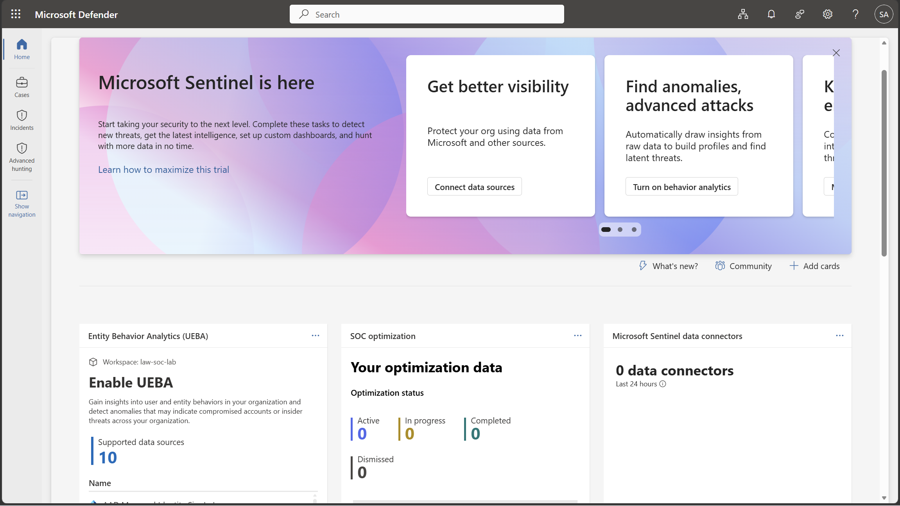
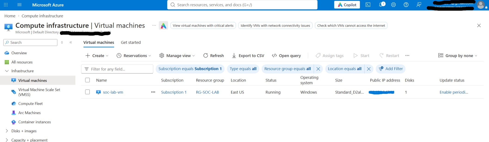
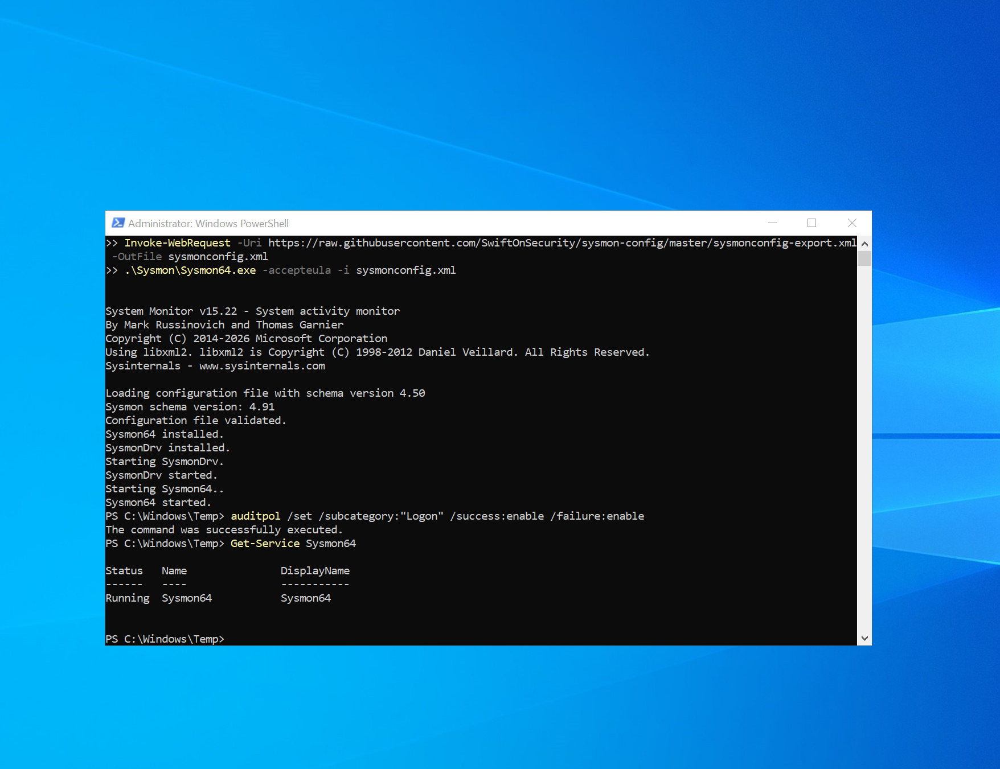
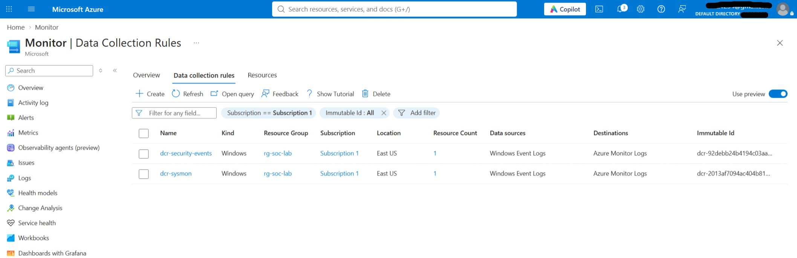
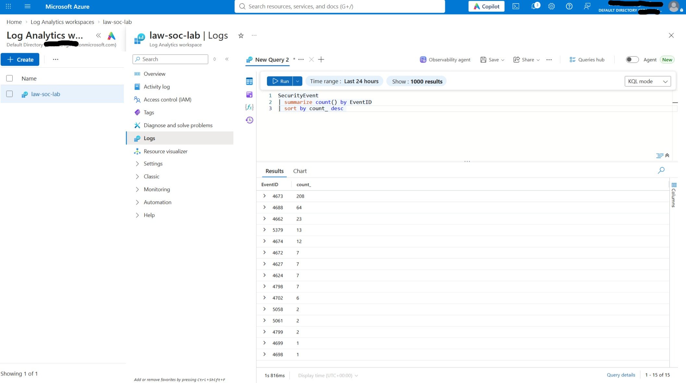
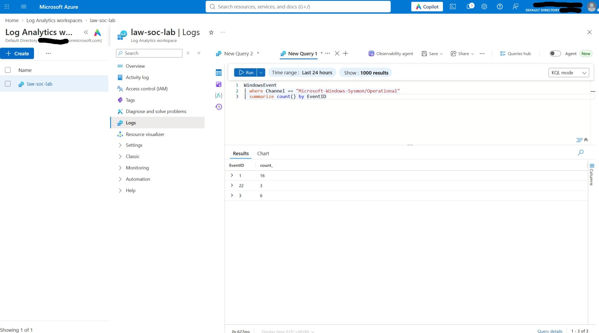
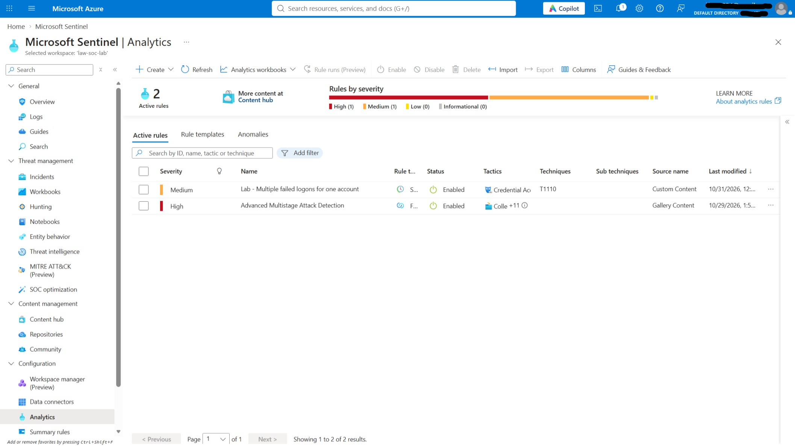
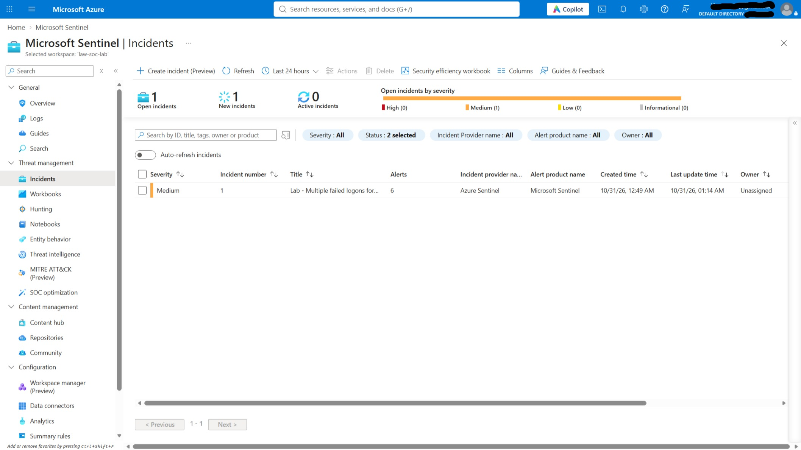
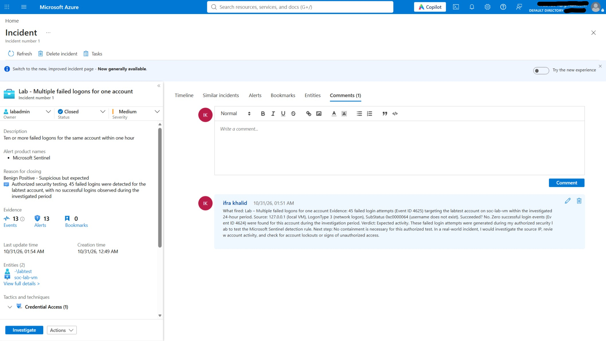

# Microsoft Sentinel SOC Home Lab

A home SOC lab built in Microsoft Azure. I deployed Microsoft Sentinel, connected a Windows virtual machine to it, wrote a detection rule for repeated failed logons, and investigated the incident it raised.

> Lab environment. All activity shown here was generated by me in my own Azure subscription for learning purposes.

## What I built

| Component | Detail |
|---|---|
| SIEM | Microsoft Sentinel on a Log Analytics workspace |
| Endpoint | Windows Server 2022 virtual machine |
| Endpoint logging | Sysmon with the SwiftOnSecurity configuration |
| Log sources | Windows Security events and Sysmon, collected by the Azure Monitor Agent through two data collection rules |
| Detection | A scheduled analytics rule for repeated failed logons, mapped to MITRE ATT&CK T1110 (Brute Force) |

## How it fits together

1. The VM generates Windows Security events and Sysmon events.
2. The Azure Monitor Agent sends them to the Log Analytics workspace, controlled by two data collection rules.
3. Sentinel analyses the logs. My analytics rule runs every five minutes and raises an incident when its conditions are met.

## Build

**Sentinel workspace**


This screenshot shows the Microsoft Sentinel environment configured with an Azure Log Analytics workspace. The workspace serves as the central location for collecting and analyzing security events from the lab enviornment.

**Virtual machine with Sysmon**



This screenshot shows my Windows Server 2022 virtual machine running in Microsoft Azure. The VM serves as the monitored endpoint where I generated failed authentication attempts to test my detection rule.


This screenshot demonstrates that Sysmon was installed and running on my Windows virtual machine using the SwiftOnSecurity configuration.

**Data collection rules**


This screenshot shows the two Data Collection Rules configured in Azure to collect Windows Security events and Sysmon logs from my virtual machine through the Azure Monitor Agent. These rules send the collected logs to Log Analytics workspace

## Verifying log ingestion

Windows Security events arriving in Sentinel:

```kql
SecurityEvent
| summarize count() by EventID
| sort by count_ desc
```


This screenshot shows my KQL query against the SecurityEvent table in Log Analytics. The query summarized Windows Security events by Event ID, allowing me to verify that security logs from my virtual machine were successfully ingested
Sysmon events arriving in Sentinel:

```kql
WindowsEvent
| where Channel == "Microsoft-Windows-Sysmon/Operational"
| summarize count() by EventID
```


This screenshot shows my KQL quert against the WindowsEvent table, filetered to the Microsoft-Windows-Sysmon/Operational channel.

## Detection rule

**Name:** Lab - Multiple failed logons per Account, Host, and Source IP
**Logic:** ten or more failed logons (Event ID 4625) within a one-hour lookback window, grouped by target account, computer, and source IP address
**Severity:** Medium
**MITRE ATT&CK:** Credential Access, T1110 Brute Force
**Schedule:** runs every 5 minutes, looks back 1 hour

```kql
SecurityEvent
| where EventID == 4625
| summarize FailedAttempts = count(),
            FirstSeen = min(TimeGenerated),
            LastSeen = max(TimeGenerated)
    by TargetAccount, Computer, IpAddress
| where FailedAttempts >= 10
```


This screenshot shows the custom scheduled analytics rule I created in Microsoft Sentinel to detect potential brute-force activity.

## Testing the detection

I simulated a brute-force attack against a test account on my Windows virtual machine by generating 15 failed logon attempts per test. I repeated the test 3 times to validate that the detection rule was working correctly. The detection rule successfully identified the threshold of 10 or more failed authentication attempts and generated a security incident for investigation.

The incident appeared approximately 60 minutes after the initial testing activity, although the analytics rule was configured to run every 5 minutes with a 1-hour lookback window. The delay may have resulted from log ingestion latency or the timing of the rule's initial execution.


This shows the security incident generated in Microsoft Sentinel following my simulated failed logon attempts. The incident demonstrates that the analytics rule detected the authentication activity and created an alert for investigation.

## Investigation

| Question | Finding |
|---|---|
| What fired? | Lab - Multiple failed logons for one account |
| Evidence | 45 failed logons (4625) for labtest on soc-lab-vm between 11:57:07 UTC and 12:44:01 UTC |
| Source | 127.0.0.1, logon type 3, sub-status 0xc0000064, account does not exist |
| Did any attempt succeed? | No. Zero 4624 events for this account |
| Verdict | Expected activity. My own test of the detection rule |
| Classification | Benign Positive, Suspicious but expected, |
| What I would do in a real case | Block the source IP, check the account for lockout, look for a successful logon after the failures |


This shows the incident after I completed my investigation and closed it as expected testing activity. I confirmed that the failed authentication attempts were generated during my own lab simulation and that no successful logons were associated with the test account.

## What I learned

- I learned how Windows security events are collected from an Azure virtual machine through Azure Monitor and sent to a Log Analytics workspace, where Microsoft Sentinel can analyze them.
- I learned how to create a custom detection rule that identifies repeated failed login attempts using Event ID 4625. I also learned how detection thresholds help identify suspicious authentication patterns
- I learned how to investigate a security incident by reviewing logon events, identifying source IP addresses, checking whether any login attempts succeeded, and documenting the results before closing the incident with the correct classification

## Tools

Microsoft Sentinel, Log Analytics, KQL, Azure Monitor Agent, Sysmon, Windows Server 2022, MITRE ATT&CK

## Queries

All the KQL I used is in [KQL_Queries.txt](KQL_Queries.txt).
